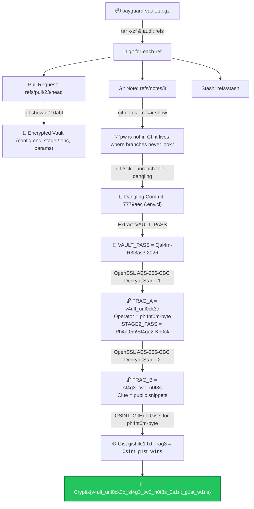

# Ghost in the Release — Cytech CTF Write-Up

<div align="center">


</div>

---

## 📋 Challenge Information

| Field | Detail |
| :--- | :--- |
| **Challenge Name** | Ghost in the Release |
| **Category** | Git Forensics / Cryptography / OSINT |
| **Author** | C1ph3r |
| **Archive File** | `payguard-vault.tar.gz` |
| **Final Flag** | `Cryptix{v4ult_unl0ck3d_st4g3_tw0_n0t3s_0s1nt_g1st_w1ns}` |

---

## 🎯 Challenge Overview

The challenge provides a compressed archive containing a Git repository: `payguard-vault.tar.gz`. While the repository's `main` branch appears clean, auditing internal Git plumbing references, Git notes, dangling commits, and PBKDF2/AES-256-CBC encrypted configuration vaults unravels an OSINT lead leading to the complete flag.

**Flag Format:**
```text
Cryptix{<Frag1>_<Frag2>_<Frag3>}
```

---

## 🗺️ Investigation Flowchart



---

## 🔍 Step-by-Step Walkthrough & Commands

### 1. Checking the Repository

Extract the provided archive:

```bash
tar -xzf payguard-vault.tar.gz
cd payguard-vault
```

Branches looked clean on `main`, but checking all internal Git references revealed hidden objects:

```bash
git for-each-ref
```

**Discovered References:**
* `refs/pull/23/head` (commit `d010abf`)
* `refs/notes/ir` (commit `a7d6f92`)
* `refs/stash` (commit `49c5f4c`)

---

### 2. Inspecting PR #23 & Git Notes

Examining commit `d010abf` (`refs/pull/23/head`):

```bash
git show d010abf
```

Found encrypted vault setup:
* `vault/config.enc`
* `vault/stage2.enc`
* `config/vault.params`:
  ```ini
  CIPHER=aes-256-cbc
  ITER=200000
  MD=sha256
  ```

Viewing the Git note in `refs/notes/ir`:

```bash
git notes --ref=ir show
```

**Note Content:**
> *"pw is not in CI. it lives where branches never look."*

---

### 3. Finding Dangling Git Objects

The phrase *"where branches never look"* directly hints at unreachable / dangling git objects outside any branch ref.

Run `git fsck`:

```bash
git fsck --unreachable --dangling --no-reflogs
```

Found two important dangling objects:

1. **Dangling tag `v2.3.1` (commit `3573063`):**
   ```bash
   git show 3573063
   ```
   * Added `package.json` postinstall hook: `node scripts/telemetry.js`
   * `scripts/telemetry.js` decoded to `https://cdn.qalam-metrics.example/u/7f3a` (explaining the suspicious outbound connection).

2. **Dangling commit `7779aec`:**
   ```bash
   git show 7779aec
   ```
   * Commit message: `"ci: add env for release pipeline"`
   * Contained `.env.ci` with:
     ```bash
     VAULT_PASS=Qal4m-R3l3as3!2026
     ```

---

### 4. Decrypting Stage 1

Using OpenSSL with the discovered password and PBKDF2 parameters:

```bash
openssl enc -d -a -aes-256-cbc -pbkdf2 -iter 200000 -md sha256 \
  -pass pass:"Qal4m-R3l3as3!2026" -in vault/config.enc
```

**Decrypted Output:**
```ini
OPERATOR=ph4nt0m-byte
FRAG_A=v4ult_unl0ck3d
STAGE2_FILE=vault/stage2.enc
STAGE2_PASS=Ph4nt0m!St4ge2-Kn0ck
```

**Extracted:**
* **Operator:** `ph4nt0m-byte`
* **Frag 1:** `v4ult_unl0ck3d`
* **Stage 2 Password:** `Ph4nt0m!St4ge2-Kn0ck`

---

### 5. Decrypting Stage 2

Using OpenSSL with the Stage 2 password:

```bash
openssl enc -d -a -aes-256-cbc -pbkdf2 -iter 200000 -md sha256 \
  -pass pass:"Ph4nt0m!St4ge2-Kn0ck" -in vault/stage2.enc
```

**Decrypted Output:**
```ini
FRAG_B=st4g3_tw0_n0t3s
NEXT=operator keeps working notes where GitHub shows public snippets
```

**Extracted:**
* **Frag 2:** `st4g3_tw0_n0t3s`
* **Pivot Clue:** Check GitHub public snippets (Gists) for operator `ph4nt0m-byte`.

---

### 6. Tracking the Operator via OSINT

Searched GitHub Gists for user `ph4nt0m-byte`:
* Direct URL: [https://gist.github.com/ph4nt0m-byte/570ad1896f103507b245575fdf422964](https://gist.github.com/ph4nt0m-byte/570ad1896f103507b245575fdf422964)

Fetching with `curl`:
```bash
curl -s https://gist.githubusercontent.com/ph4nt0m-byte/570ad1896f103507b245575fdf422964/raw/gistfile1.txt
```

**Content of `gistfile1.txt`:**
```text
frag3: 0s1nt_g1st_w1ns
```

* **Frag 3:** `0s1nt_g1st_w1ns`

---

## 🚩 Final Flag

Combine all three fragments:
* Frag 1: `v4ult_unl0ck3d`
* Frag 2: `st4g3_tw0_n0t3s`
* Frag 3: `0s1nt_g1st_w1ns`

```text
Cryptix{v4ult_unl0ck3d_st4g3_tw0_n0t3s_0s1nt_g1st_w1ns}
```

---

## 💡 Summary Attack Chain

```text
Pull request 23 + Git notes
└── Dangling git commits (git fsck)
    └── Found VAULT_PASS in orphaned .env.ci
        └── Decrypt config.enc (FRAG_A: v4ult_unl0ck3d + operator ph4nt0m-byte)
            └── Decrypt stage2.enc (FRAG_B: st4g3_tw0_n0t3s + GitHub Gist clue)
                └── OSINT on GitHub Gists for ph4nt0m-byte
                    └── frag3: 0s1nt_g1st_w1ns
                        └── Cryptix{v4ult_unl0ck3d_st4g3_tw0_n0t3s_0s1nt_g1st_w1ns}
```
